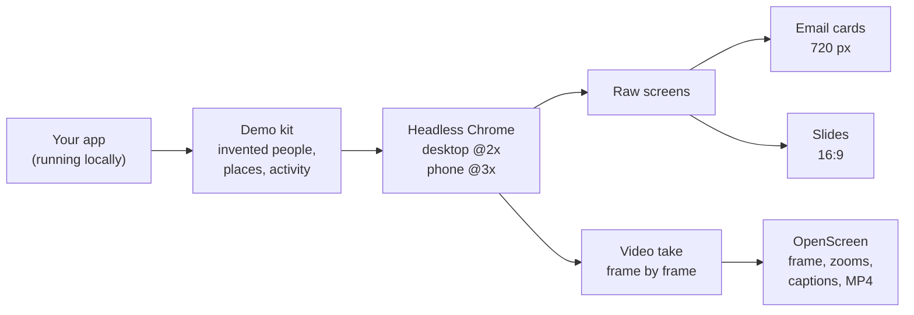

<div align="center">

# claude-skills

**Skills for Claude Code that work on any project, any stack.**

Install once, then just ask Claude in plain words.


</div>

---

## Plugins

| | Plugin | What it does |
|---|---|---|
| 📸 | **[showcase](plugins/showcase)** | Real screenshots of your running web app, filled with believable demo data, delivered as raw screens, email cards, 16:9 slides or a short video clip. |

## Install

In Claude Code (terminal or desktop):

```text
/plugin marketplace add <this repo's URL>
/plugin install showcase@ovidiu-skills
```

Copy the URL from the green **Code** button above. That's it: the skill is now available in
every project you open.

To update, run both in a terminal, then restart Claude Code (the first only refreshes the
list of versions; the second updates your installed copy):

```bash
claude plugin marketplace update ovidiu-skills
claude plugin update showcase@ovidiu-skills
```

> You can also just give Claude the repo URL and say *"install the showcase plugin from
> this marketplace"*. It runs the same two commands.

## Using showcase

Ask for pictures the way you'd ask a colleague:

> *"Make screenshots of the dashboard and the mobile check-in for a client deck."*
>
> *"Three email cards about this week's changes, for the team."*
>
> *"Redo last month's deck for another brand."*
>
> *"A 30-second video of a promoter filling in the shelf audit on the phone."*

The first time in a project, Claude sets it up with you: how the app starts, a demo-data
kit with an invented brand, and the screens to shoot. All of it lives in a `.showcase/`
folder in that project, so the next set takes minutes.



**Honest by design.** Every picture is a real render of the real app. Nothing is drawn,
mocked up or retouched; composing only crops and arranges real screenshots, and a video is the real app filmed frame by frame.

**Safe by design.** Demo data only ever goes into a local database. The tools only drive a
Chrome they started themselves, and never send mail or touch your everyday browser.

Works with Laravel, Django, Rails, Next.js, Vite, plain PHP, WordPress, single-page apps and
server-rendered sites. More in the [plugin's README](plugins/showcase/README.md).

## Working on the skills

```bash
npm test            # unit tests, no browser
npm run test:e2e    # end to end: a small fixture app in real headless Chrome (port 9450)
npm run test:all    # both
```

Needs Node 22.4+ and Chrome (or Edge). There's nothing to `npm install`.

To try a change before pushing, add your local copy as the marketplace in a test session:
`/plugin marketplace add <path to this folder>`.

<details>
<summary><b>Repository layout</b></summary>

```text
.claude-plugin/marketplace.json     the marketplace: lists the plugins
plugins/<plugin>/
  .claude-plugin/plugin.json        name, version, description
  README.md                         what the plugin does, for humans
  skills/<skill>/SKILL.md           what Claude reads
  skills/<skill>/reference/         details SKILL.md points to
  skills/<skill>/tools/             scripts the skill runs
tests/unit/  tests/e2e/             node:test suites
```

Bump a plugin's `version` in its `plugin.json` when you change it, so installs pick it up.

</details>

## License

[MIT](LICENSE)
